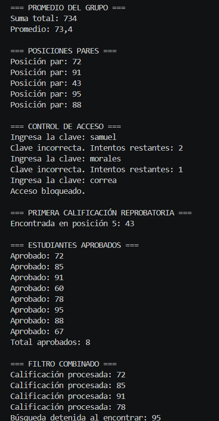
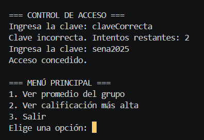
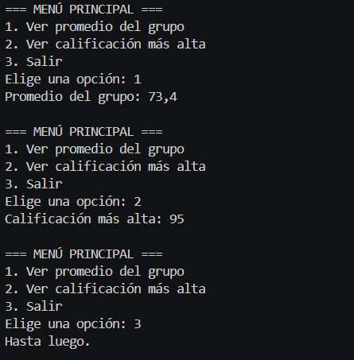

# EV05 - Aplicación de la sintaxis básica de C# - Estructuras de control Iterativo

**Código de evidencia:** 220501097-04-AA1 – EV05  
**Programa de formación:** Análisis y Desarrollo de Software (ADSO) - SENA  
**Lenguaje:** C# (.NET SDK)  

---

## 📌 Descripción del Proyecto

Este proyecto aplica las estructuras de control iterativo en C# para resolver un problema práctico de gestión de calificaciones escolares. Se hace uso de:

1. **Bucles `for` y `foreach`**: Para recorrido ascendente, descendente, saltos de posición e iteraciones sobre arrays.
2. **Bucles `while` y `do-while`**: Para validación de credenciales con número límite de intentos y menú interactivo de consola.
3. **Sentencias de control `break` y `continue`**: Para interrupción temprana de búsquedas y filtrado eficiente de elementos.

---

## 🚀 Requisitos e Instalación

- SDK de .NET versión 6.0 o superior.
- Editor de código (Visual Studio Code o Visual Studio).

# Ejecutar el proyecto
dotnet run

### Salidas de ejecución

#### Salida 1

#### Salida 2

#### Salida 3
